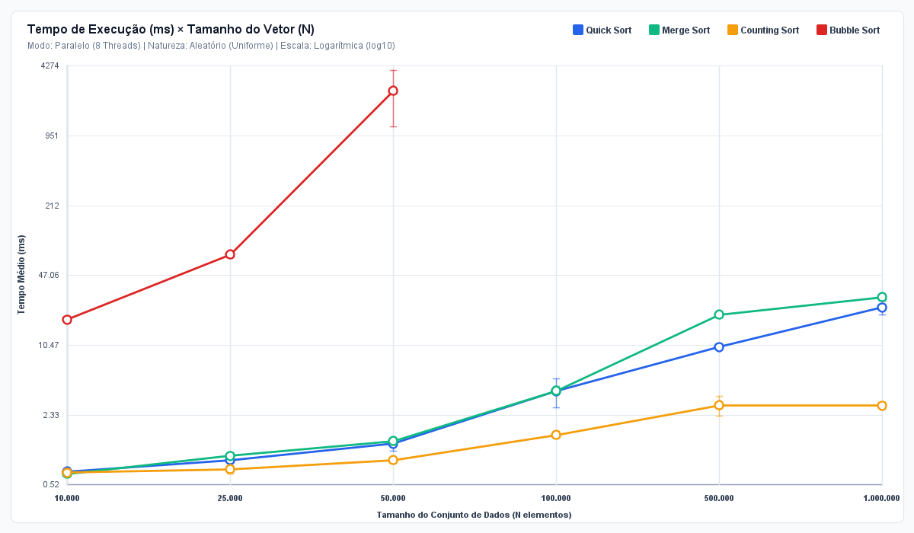

|  | **UNIVERSIDADE DE FORTALEZA** **CENTRO DE CIÊNCIAS TECNOLÓGICAS** **CURSO: CIÊNCIA DA COMPUTAÇÃO** |
| :---: | :--- |

# ANÁLISE DE DESEMPENHO DE ALGORITMOS DE BUSCA EM AMBIENTES CONCORRENTES E PARALELOS: UM ESTUDO COMPARATIVO EM JAVA

*Autor 1: Victor Lins.*  
*Autor 2: Diogo Guimarães Gifoni.*  

**Palavras-chave:** Computação Paralela. Algoritmos de Ordenação. Java Fork/Join. Speedup. Análise Estatística.

## Resumo

Este trabalho analisa experimentalmente o desempenho de quatro algoritmos de ordenação, etapa que antecede e viabiliza a busca eficiente de dados, em versões sequenciais e paralelas implementadas em Java: Quick Sort, Merge Sort, Counting Sort e Bubble Sort (na formulação paralela Odd-Even Transposition). Foi desenvolvido um framework de testes que varia o tamanho dos conjuntos de dados (10.000 a 1.000.000 de elementos), a natureza da entrada (aleatória, inversamente ordenada, quase ordenada e com poucas chaves distintas), o intervalo de valores e o número de threads (1, 2, 4, 8 e 16), com cinco amostras por configuração e registro dos resultados em arquivos CSV. Para N = 1.000.000, o Merge Sort e o Quick Sort paralelos atingiram Speedups de 4,18x e 4,28x, respectivamente. O Bubble Sort Odd-Even alcançou 1,22x com 4 threads para N = 50.000, limitado pelo custo das barreiras de sincronização entre fases. O Counting Sort obteve os menores tempos absolutos, mas, por ser limitado pela memória, praticamente não se beneficiou do paralelismo e mostrou forte sensibilidade à amplitude k do intervalo de valores. Os resultados foram visualizados em uma aplicação de gráficos dinâmicos em Java Swing e em Jupyter Notebook.

## Introdução

A ordenação é uma das operações mais estudadas da Ciência da Computação, pois algoritmos de busca eficientes, como a busca binária em O(log n), as consultas por intervalo e a indexação em bancos de dados, pressupõem dados previamente ordenados. Com a consolidação dos processadores multicore, reduzir o tempo dessas operações passou a depender não só da complexidade assintótica, mas também da capacidade de dividir o trabalho entre núcleos e dos custos de sincronização, comunicação e acesso à memória que essa divisão introduz.

Dentre os seis algoritmos propostos no enunciado, foram escolhidos quatro que representam paradigmas e classes de complexidade distintos: (i) Quick Sort, divisão e conquista in-place com complexidade média O(n log n), aqui com pivô por mediana de três e particionamento de Hoare; (ii) Merge Sort, divisão e conquista estável com O(n log n) garantido no pior caso; (iii) Counting Sort, método não comparativo de complexidade O(n + k), em que k é a amplitude do intervalo de valores; e (iv) Bubble Sort, método elementar O(n²) baseado em trocas de elementos adjacentes.

A abordagem de paralelização utilizou as ferramentas do pacote java.util.concurrent. Quick Sort e Merge Sort foram paralelizados com o framework Fork/Join (ForkJoinPool e RecursiveAction), cujo escalonador por roubo de trabalho (work-stealing) distribui as subtarefas recursivas entre as threads, com um limiar de granularidade abaixo do qual a recursão prossegue sequencialmente. O Counting Sort paralelo usa histogramas locais por thread (sem locks), redução paralela por faixas de valores e escrita paralela em regiões disjuntas, limitando o número de histogramas quando k é grande em relação a n. O Bubble Sort foi paralelizado pelo Odd-Even Transposition Sort, sua formulação paralela clássica: as comparações de cada fase envolvem pares disjuntos e podem ser feitas simultaneamente, e as fases são separadas por uma barreira (Phaser). Para que o Speedup meça apenas o ganho do paralelismo, a versão serial de cada algoritmo executa exatamente o mesmo procedimento da versão paralela em uma única thread.

## Metodologia

Foi desenvolvido em Java um framework de testes composto pelas classes ExecutorBenchmark (orquestração dos experimentos), GeradorDados (geração determinística das entradas) e ExportadorCSV (gravação dos resultados), além da interface comum AlgoritmoOrdenacao, que obriga cada algoritmo a oferecer um método serial e um paralelo parametrizado pelo número de threads. Os experimentos foram executados em um notebook Acer Nitro V com processador AMD Ryzen 7 7735HS, com 8 núcleos físicos e 16 threads via SMT (24 processadores lógicos visíveis à JVM), sistema operacional Windows 11 10.0 e OpenJDK 64-Bit Server VM (Java 25.0.5). Antes das medições, o framework executa ciclos de aquecimento da JVM para que o compilador Just-In-Time otimize os métodos medidos.

O protocolo seguiu um projeto fatorial com quatro fatores: (1) número de threads: execução serial (1 thread) e paralela com 2, 4, 8 e 16 threads, sendo que o paralelismo do pool limita a quantidade de núcleos usados simultaneamente, o que permite investigar o efeito de disponibilizar mais ou menos núcleos ao algoritmo; (2) tamanho N: 10.000, 25.000, 50.000, 100.000, 500.000 e 1.000.000 de inteiros, com o Bubble Sort limitado a N = 50.000 por ser quadrático; (3) natureza dos dados: aleatório uniforme, inversamente ordenado, quase ordenado (10% dos elementos fora de posição) e poucos valores únicos (até 32 chaves); e (4) intervalo de valores [0..k], com k em {1.000; 100.000; 1.000.000; 10.000.000} para N = 500.000, comparando-se a execução serial com a paralela de 8 threads.

Para cada configuração foram coletadas 5 amostras, com sementes pseudoaleatórias fixas, de modo que todos os algoritmos e quantidades de threads processem exatamente os mesmos vetores. O tempo foi medido com System.nanoTime() e cada resultado foi verificado quanto à ordenação correta. A análise estatística dos resultados obtidos calcula, por configuração, média, desvio padrão amostral (s), mediana, mínimo, máximo e coeficiente de variação (CV = s / média), além das métricas de desempenho paralelo Speedup (Sp = T1 / Tp) e Eficiência (Ep = Sp / p), interpretadas à luz da Lei de Amdahl, para identificar padrões de desempenho e comparar os algoritmos sob diferentes condições. Os dados foram gravados em três arquivos CSV (amostras individuais, resumo estatístico e experimento de intervalo de valores) e visualizados em gráficos gerados em Python, em Jupyter Notebook e em uma aplicação de gráficos dinâmicos em Java Swing.

## Resultados e Discussão

### Escalabilidade em função do tamanho dos dados

A Figura 1 mostra o crescimento do tempo de execução com N. As três classes de complexidade aparecem separadas por ordens de grandeza: para N = 50.000 elementos aleatórios, a execução serial levou em média 1.646,94 ms no Bubble Sort, 3,72 ms no Merge Sort, 2,54 ms no Quick Sort e 0,51 ms no Counting Sort. A Tabela 1 detalha a estatística das cinco amostras para esse tamanho.

**Figura 1 – Tempo médio de execução em função do tamanho N (serial e paralelo)**

*Fonte: elaborado pelos autores (2026).*

**Tabela 1 – Estatísticas para N = 50.000 (dados aleatórios, 5 amostras)**

| Algoritmo | Modo | Threads | Média (ms) | Desvio (ms) | Mediana (ms) | CV | Speedup | Eficiência |
|---|---|---|---|---|---|---|---|---|
| Quick Sort | Serial | 1 | 2,539 | 0,115 | 2,508 | 4,5% | 1,00x | 100,0% |
| Quick Sort | Paralelo | 2 | 1,874 | 0,423 | 1,719 | 22,6% | 1,35x | 67,7% |
| Quick Sort | Paralelo | 4 | 1,432 | 0,403 | 1,279 | 28,1% | 1,77x | 44,3% |
| Quick Sort | Paralelo | 8 | 1,236 | 0,179 | 1,190 | 14,5% | 2,05x | 25,7% |
| Quick Sort | Paralelo | 16 | 1,591 | 0,621 | 1,301 | 39,0% | 1,60x | 10,0% |
| Merge Sort | Serial | 1 | 3,718 | 0,071 | 3,741 | 1,9% | 1,00x | 100,0% |
| Merge Sort | Paralelo | 2 | 2,165 | 0,077 | 2,176 | 3,6% | 1,72x | 85,9% |
| Merge Sort | Paralelo | 4 | 1,500 | 0,070 | 1,530 | 4,6% | 2,48x | 62,0% |
| Merge Sort | Paralelo | 8 | 1,314 | 0,041 | 1,300 | 3,1% | 2,83x | 35,4% |
| Merge Sort | Paralelo | 16 | 1,472 | 0,163 | 1,419 | 11,1% | 2,52x | 15,8% |
| Counting Sort | Serial | 1 | 0,505 | 0,069 | 0,477 | 13,7% | 1,00x | 100,0% |
| Counting Sort | Paralelo | 2 | 0,670 | 0,030 | 0,671 | 4,5% | 0,75x | 37,7% |
| Counting Sort | Paralelo | 4 | 0,818 | 0,078 | 0,837 | 9,5% | 0,62x | 15,4% |
| Counting Sort | Paralelo | 8 | 0,872 | 0,055 | 0,870 | 6,4% | 0,58x | 7,2% |
| Counting Sort | Paralelo | 16 | 1,660 | 0,319 | 1,812 | 19,2% | 0,30x | 1,9% |
| Bubble Sort | Serial | 1 | 1.646,944 | 93,590 | 1.632,646 | 5,7% | 1,00x | 100,0% |
| Bubble Sort | Paralelo | 2 | 1.479,507 | 773,735 | 1.304,010 | 52,3% | 1,11x | 55,7% |
| Bubble Sort | Paralelo | 4 | 1.352,561 | 752,208 | 1.130,273 | 55,6% | 1,22x | 30,4% |
| Bubble Sort | Paralelo | 8 | 2.477,039 | 1.338,744 | 3.174,406 | 54,0% | 0,66x | 8,3% |
| Bubble Sort | Paralelo | 16 | 4.015,689 | 598,433 | 3.717,812 | 14,9% | 0,41x | 2,6% |

*Fonte: elaborado pelos autores (2026).*

### Speedup e eficiência por número de threads

Para N = 1.000.000 (Tabela 2 e Figuras 2 e 3), os algoritmos de divisão e conquista foram os que mais se beneficiaram do paralelismo. O Merge Sort caiu de 121,34 ms (serial) para 29,04 ms com 8 threads (Speedup de 4,18x), e o Quick Sort caiu de 96,68 ms para 22,57 ms com 16 threads (Speedup de 4,28x). Ainda assim, a eficiência com 16 threads ficou em 26,0% e 26,8%, respectivamente: como prevê a Lei de Amdahl, as partes sequenciais (o primeiro particionamento do Quick Sort e a última intercalação do Merge Sort percorrem o vetor inteiro em uma única thread) e a disputa pela largura de banda da memória limitam o ganho. Há ainda um limite de hardware: o processador possui 8 núcleos físicos, de modo que acima de 8 threads os núcleos passam a ser compartilhados por duas threads via SMT (Simultaneous Multithreading), que dividem as mesmas unidades de execução e caches. Por isso, de 8 para 16 threads o Speedup passou de 4,18x para 4,16x no Merge Sort e de 4,15x para 4,28x no Quick Sort, chegando a cair: o custo de coordenar mais threads superou o ganho do SMT.

Para cargas pequenas o comportamento se inverte: com N = 10.000 e 16 threads o Speedup foi de 0,74x no Quick Sort e 0,83x no Merge Sort, pois o custo de criar o pool e distribuir as tarefas é comparável ao próprio tempo de ordenação. O Counting Sort, por sua vez, já é muito rápido na versão serial (3,77 ms para N = 1.000.000) e seu melhor Speedup foi de 1,34x (8 threads): por ser limitado pela memória, e não pelo processamento, dividir os acessos entre núcleos não reduz o gargalo, e as fases extras de alocação e redução dos histogramas locais anulam boa parte do ganho.

O Bubble Sort Odd-Even (N = 50.000) reduziu o tempo de 1.646,94 ms para 1.352,56 ms com 4 threads (Speedup de 1,22x), com eficiência de 2,6% em 16 threads. Como as versões serial e paralela executam as mesmas fases e comparações, esse ganho decorre exclusivamente da divisão de cada fase entre as threads. O limite vem da sincronização: o algoritmo executa até N fases, cada uma terminada por uma barreira; com mais threads, o trabalho por fase de cada thread diminui (N / 2p comparações), enquanto o custo de cada barreira aumenta, de modo que a espera passa a dominar o tempo total.

**Figura 2 – Tempo médio e desvio padrão (5 amostras) por número de threads**

*Fonte: elaborado pelos autores (2026).*

**Figura 3 – Speedup (Sp) e Eficiência (Ep) em função do número de threads**

*Fonte: elaborado pelos autores (2026).*

**Tabela 2 – Estatísticas para N = 1.000.000 (dados aleatórios, 5 amostras)**

| Algoritmo | Modo | Threads | Média (ms) | Desvio (ms) | Mediana (ms) | CV | Speedup | Eficiência |
|---|---|---|---|---|---|---|---|---|
| Quick Sort | Serial | 1 | 96,676 | 14,940 | 100,213 | 15,5% | 1,00x | 100,0% |
| Quick Sort | Paralelo | 2 | 44,995 | 1,757 | 45,876 | 3,9% | 2,15x | 107,4% |
| Quick Sort | Paralelo | 4 | 27,803 | 3,050 | 27,039 | 11,0% | 3,48x | 86,9% |
| Quick Sort | Paralelo | 8 | 23,297 | 3,332 | 22,852 | 14,3% | 4,15x | 51,9% |
| Quick Sort | Paralelo | 16 | 22,572 | 1,583 | 22,407 | 7,0% | 4,28x | 26,8% |
| Merge Sort | Serial | 1 | 121,337 | 5,605 | 121,216 | 4,6% | 1,00x | 100,0% |
| Merge Sort | Paralelo | 2 | 59,603 | 0,305 | 59,424 | 0,5% | 2,04x | 101,8% |
| Merge Sort | Paralelo | 4 | 37,010 | 2,080 | 37,782 | 5,6% | 3,28x | 82,0% |
| Merge Sort | Paralelo | 8 | 29,043 | 1,905 | 28,050 | 6,6% | 4,18x | 52,2% |
| Merge Sort | Paralelo | 16 | 29,162 | 2,235 | 27,808 | 7,7% | 4,16x | 26,0% |
| Counting Sort | Serial | 1 | 3,769 | 0,152 | 3,770 | 4,0% | 1,00x | 100,0% |
| Counting Sort | Paralelo | 2 | 3,448 | 1,021 | 2,959 | 29,6% | 1,09x | 54,6% |
| Counting Sort | Paralelo | 4 | 3,399 | 1,125 | 3,124 | 33,1% | 1,11x | 27,7% |
| Counting Sort | Paralelo | 8 | 2,808 | 0,157 | 2,845 | 5,6% | 1,34x | 16,8% |
| Counting Sort | Paralelo | 16 | 3,274 | 0,282 | 3,275 | 8,6% | 1,15x | 7,2% |

*Fonte: elaborado pelos autores (2026).*

### Impacto da natureza dos dados e do intervalo de valores

A Figura 4 compara as quatro naturezas de entrada para N = 100.000. Com pivô por mediana de três e particionamento de Hoare, o Quick Sort manteve o comportamento O(n log n) mesmo nas entradas inversamente ordenadas e com muitas chaves repetidas, que levariam uma implementação com pivô fixo ao pior caso O(n²). O Merge Sort foi mais rápido nas entradas quase ordenadas e com poucas chaves distintas, pois verifica se dois subvetores adjacentes já estão em ordem antes de intercalá-los.

A Figura 5 e a Tabela 3 mostram o tempo em função do intervalo de valores [0..k] para N = 500.000. Quick Sort e Merge Sort, baseados em comparações, praticamente não variam com k. Já o Counting Sort depende diretamente de k: com k = 100.000 levou 1,26 ms (serial), mas com k = 10.000.000 subiu para 13,94 ms, pois o vetor de contagem passa a ser 20 vezes maior que a entrada (o Quick Sort serial levou 27,67 ms nesse cenário). Na versão paralela, cada thread precisaria de um histograma próprio de tamanho k, multiplicando a memória alocada; por isso a implementação limita o número de histogramas a 2n/k e, quando esse limite é 1, realiza a contagem sequencialmente. Assim, com k = 10.000.000 a versão de 8 threads registrou 14,74 ms, próximo da serial, evitando a degradação causada pela alocação de vários histogramas grandes.

**Figura 4 – Impacto da natureza dos dados no tempo médio de execução (N = 100.000)**

*Fonte: elaborado pelos autores (2026).*

**Figura 5 – Tempo de execução em função do intervalo de valores [0..k] (N = 500.000)**

*Fonte: elaborado pelos autores (2026).*

**Tabela 3 – Impacto do intervalo de valores [0..k] (N = 500.000, 5 amostras)**

| Algoritmo | Modo | Threads | k | Média (ms) | Desvio (ms) | Speedup |
|---|---|---|---|---|---|---|
| Counting Sort | Serial | 1 | 1.000 | 0,444 | 0,017 | 1,00x |
| Counting Sort | Paralelo | 8 | 1.000 | 0,609 | 0,124 | 0,73x |
| Merge Sort | Serial | 1 | 1.000 | 29,108 | 0,470 | 1,00x |
| Merge Sort | Paralelo | 8 | 1.000 | 6,480 | 0,367 | 4,49x |
| Quick Sort | Serial | 1 | 1.000 | 18,696 | 0,323 | 1,00x |
| Quick Sort | Paralelo | 8 | 1.000 | 5,534 | 0,262 | 3,38x |
| Counting Sort | Serial | 1 | 100.000 | 1,264 | 0,056 | 1,00x |
| Counting Sort | Paralelo | 8 | 100.000 | 1,022 | 0,153 | 1,24x |
| Merge Sort | Serial | 1 | 100.000 | 40,330 | 3,197 | 1,00x |
| Merge Sort | Paralelo | 8 | 100.000 | 10,519 | 0,642 | 3,83x |
| Quick Sort | Serial | 1 | 100.000 | 27,838 | 1,081 | 1,00x |
| Quick Sort | Paralelo | 8 | 100.000 | 10,800 | 1,201 | 2,58x |
| Counting Sort | Serial | 1 | 1.000.000 | 4,591 | 0,475 | 1,00x |
| Counting Sort | Paralelo | 8 | 1.000.000 | 8,110 | 3,010 | 0,57x |
| Merge Sort | Serial | 1 | 1.000.000 | 37,192 | 1,121 | 1,00x |
| Merge Sort | Paralelo | 8 | 1.000.000 | 9,847 | 0,508 | 3,78x |
| Quick Sort | Serial | 1 | 1.000.000 | 27,856 | 0,716 | 1,00x |
| Quick Sort | Paralelo | 8 | 1.000.000 | 7,321 | 0,366 | 3,80x |
| Counting Sort | Serial | 1 | 10.000.000 | 13,944 | 0,378 | 1,00x |
| Counting Sort | Paralelo | 8 | 10.000.000 | 14,739 | 1,183 | 0,95x |
| Merge Sort | Serial | 1 | 10.000.000 | 40,782 | 4,743 | 1,00x |
| Merge Sort | Paralelo | 8 | 10.000.000 | 13,674 | 1,218 | 2,98x |
| Quick Sort | Serial | 1 | 10.000.000 | 27,668 | 1,331 | 1,00x |
| Quick Sort | Paralelo | 8 | 10.000.000 | 8,272 | 0,584 | 3,34x |

*Fonte: elaborado pelos autores (2026).*

### Variabilidade das amostras e gráficos dinâmicos

A Figura 6 apresenta a dispersão das cinco amostras para N = 1.000.000. O coeficiente de variação mediano nesse tamanho foi de 7,4%, indicando medições estáveis após o aquecimento da JVM; a variabilidade é maior nas cargas pequenas, em que interferências do sistema operacional e do coletor de lixo têm peso relativo maior. Como ponto extra, foi desenvolvida uma aplicação de gráficos dinâmicos em Java Swing (Figura 7), que lê os CSVs ou executa novos testes e permite filtrar em tempo real por natureza dos dados, tamanho, número de threads e escala logarítmica, com dicas interativas sobre cada ponto medido.

**Figura 6 – Dispersão das 5 amostras para N = 1.000.000**

*Fonte: elaborado pelos autores (2026).*

**Figura 7 – Gráfico dinâmico gerado pela aplicação em Java Swing**

*Fonte: elaborado pelos autores (2026).*

## Conclusão

Os experimentos mostraram que o ganho com paralelismo depende tanto do algoritmo quanto do volume de dados. Para grandes volumes (N ≥ 100.000), as versões paralelas do Merge Sort e do Quick Sort com Fork/Join oferecem o melhor equilíbrio entre tempo absoluto e escalabilidade, com Speedups de 4,18x e 4,28x, embora a eficiência caia à medida que se adicionam threads. O Counting Sort é o mais rápido quando k é pequeno em relação a N, mas, sendo limitado pela memória, quase não escala com mais núcleos e degrada quando k cresce. O Bubble Sort Odd-Even confirma que um algoritmo quadrático pode ser acelerado pela divisão do trabalho de cada fase, mas o grande número de barreiras limita o Speedup. Por fim, para cargas pequenas o custo de coordenação das threads supera o ganho, o que reforça o uso de limiares de granularidade e a escolha do algoritmo adequado ao perfil dos dados antes de simplesmente aumentar o número de threads.

## Referências

AMDAHL, G. M. Validity of the single processor approach to achieving large scale computing capabilities. In: **AFIPS Spring Joint Computer Conference**, v. 30, p. 483-485, 1967.

CORMEN, T. H.; LEISERSON, C. E.; RIVEST, R. L.; STEIN, C. **Algoritmos**: teoria e prática. 4. ed. Rio de Janeiro: GEN LTC, 2024.

GOETZ, B. et al. **Java Concurrency in Practice**. Boston: Addison-Wesley, 2006.

GRAMA, A.; GUPTA, A.; KARYPIS, G.; KUMAR, V. **Introduction to Parallel Computing**. 2. ed. Harlow: Addison-Wesley, 2003.

LEA, D. A Java Fork/Join Framework. In: **Proceedings of the ACM 2000 Conference on Java Grande**. New York: ACM, 2000. p. 36-43.

ORACLE. **Java Platform, Standard Edition API Specification**: java.util.concurrent. Disponível em: https://docs.oracle.com/en/java/javase/. Acesso em: 30 out. 2026.

SEDGEWICK, R.; WAYNE, K. **Algorithms**. 4. ed. Boston: Addison-Wesley, 2011.

## Anexos

Repositório com o código-fonte completo, CSVs, aplicação Swing e Jupyter Notebook: [https://github.com/Victor-Lins14/Comp_Paralela](https://github.com/Victor-Lins14/Comp_Paralela)

- [Anexo A — Quick Sort (src/algoritmos/QuickSort.java)](src/algoritmos/QuickSort.java)
- [Anexo B — Merge Sort (src/algoritmos/MergeSort.java)](src/algoritmos/MergeSort.java)
- [Anexo C — Counting Sort (src/algoritmos/CountingSort.java)](src/algoritmos/CountingSort.java)
- [Anexo D — Bubble Sort Odd-Even (src/algoritmos/BubbleSort.java)](src/algoritmos/BubbleSort.java)
- [Anexo E — Framework de testes (src/benchmark/ExecutorBenchmark.java)](src/benchmark/ExecutorBenchmark.java)
