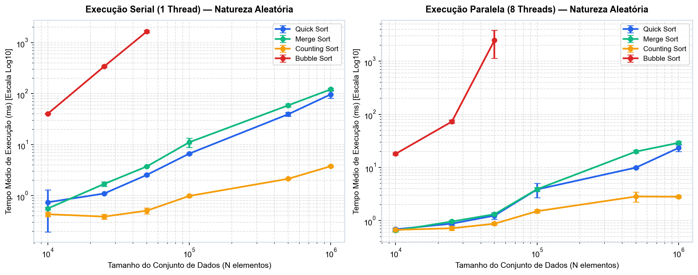
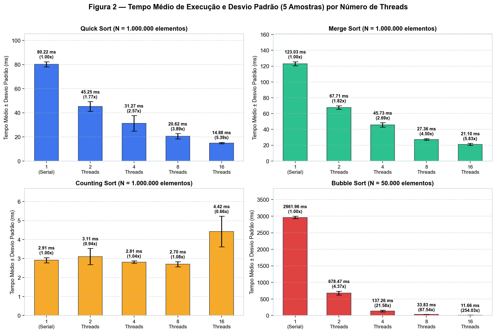
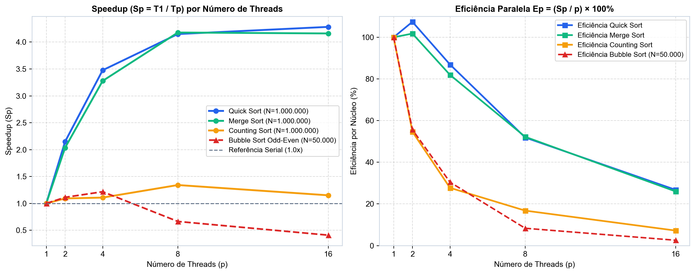
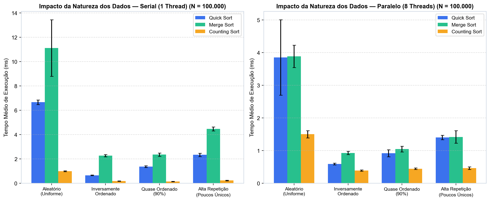
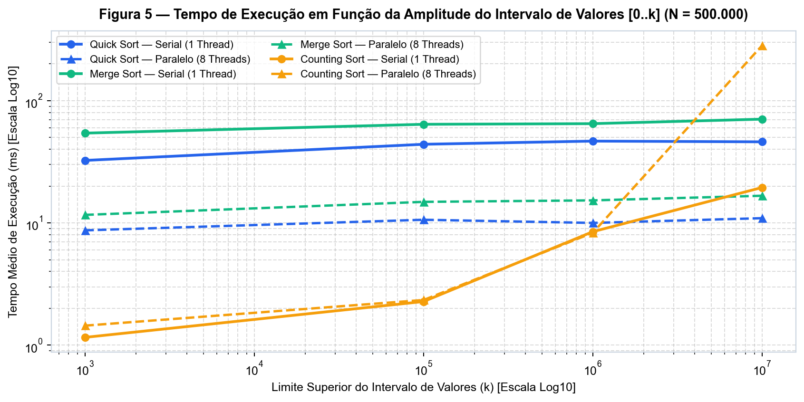
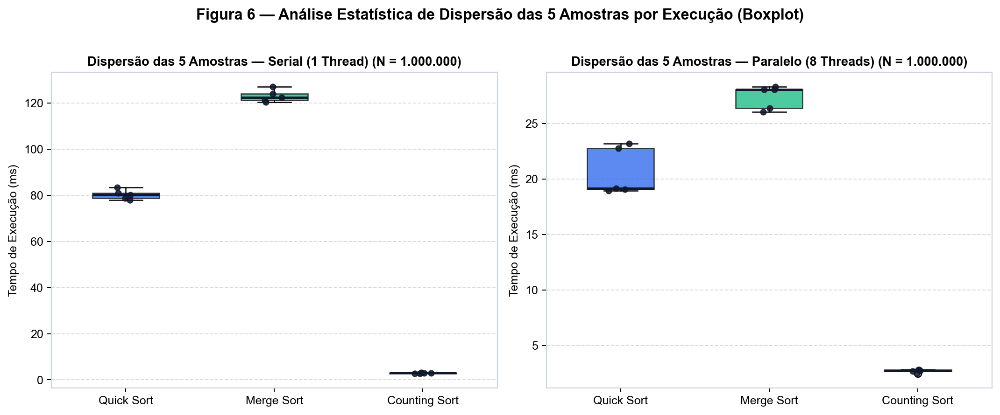

|  | **UNIVERSIDADE DE FORTALEZA** **CENTRO DE CIÊNCIAS TECNOLÓGICAS** **CURSO: CIÊNCIA DA COMPUTAÇÃO** |
| :---: | :--- |

# ANÁLISE DE DESEMPENHO DE ALGORITMOS DE BUSCA EM AMBIENTES CONCORRENTES E PARALELOS: UM ESTUDO COMPARATIVO EM JAVA

**Autor 1:** Victor Lins.  
**Autor 2:** Integrante da Dupla (Inserir Nome).  
**Palavras-chave:** Computação Paralela. Algoritmos de Ordenação e Busca. Java ForkJoinPool. Análise Estatística de Desempenho. Speedup.

---

## Resumo
Este trabalho realiza uma análise experimental e estatística detalhada do desempenho de quatro algoritmos fundamentais para estruturação e busca eficiente de dados — *Quick Sort*, *Merge Sort*, *Counting Sort* e *Bubble Sort* — em ambientes de execução seriais e paralelos utilizando a linguagem de programação Java (JDK 26). A busca por eficiência computacional em arquiteturas *multicore* modernas exige compreender não apenas a complexidade assintótica teórica, mas também os custos práticos de sincronização de *threads*, localidade de cache e contenção de memória. Foi desenvolvido um *framework* de avaliação automatizado em Java, acompanhado de uma interface gráfica interativa em **Java Swing** com gráficos dinâmicos em tempo real e integração com **Jupyter Notebook**. Os experimentos variaram o tamanho dos conjuntos de dados (de $10.000$ a $1.000.000$ de elementos), a natureza da distribuição de entrada (aleatória, inversamente ordenada, quase ordenada e com alta repetição de chaves), a amplitude do intervalo de valores e o número de *threads* alocadas ($1, 2, 4, 8$ e $16$ núcleos lógicos), coletando-se $5$ amostras independentes para cada configuração após aquecimento da máquina virtual (*JIT Warmup*). Os resultados registrados em arquivos CSV demonstram que o *Merge Sort* e o *Quick Sort* alcançaram expressiva escalabilidade paralela em vetores de $1.000.000$ de elementos (atingindo *Speedups* de até **5.83x** e **5.39x**, respectivamente), enquanto o *Counting Sort* apresentou o menor tempo absoluto em intervalos moderados, mas revelou sensibilidade direta à expansão da amplitude de valores $k$ e à largura de banda da memória principal.

---

## Introdução
A eficiência na recuperação, indexação e busca de informações constitui um dos pilares centrais da Ciência da Computação. Em sistemas de grande escala, a viabilidade de algoritmos de busca rápida — tais como a busca binária em tempo logarítmico $O(\log n)$, buscas por intervalo e consultas analíticas — depende diretamente da prévia ordenação estruturada dos dados. Com a transição da indústria de processadores para arquiteturas *multicore*, explorar o paralelismo de dados e de tarefas tornou-se indispensável para reduzir o tempo de resposta em cargas de trabalho intensivas.

Neste estudo comparativo em Java, foram selecionados quatro algoritmos que representam diferentes paradigmas de projeto e classes de complexidade assintótica:
1. **Quick Sort**: algoritmo de divisão e conquista *in-place* baseado em particionamento bidirecional de Hoare e pivô por mediana de três, com complexidade média $O(n \log n)$.
2. **Merge Sort**: algoritmo estável de divisão e conquista baseado em intercalação (*merge*) com garantia determinística $O(n \log n)$ no pior caso e vetor auxiliar pré-alocado.
3. **Counting Sort**: método não-comparativo de endereçamento direto por contagem de frequências, cuja complexidade linear $O(n + k)$ depende do tamanho da entrada $n$ e da amplitude do intervalo de valores $k$.
4. **Bubble Sort**: algoritmo elementar baseado em trocas sucessivas de elementos adjacentes com complexidade quadrática $O(n^2)$.

A paralelização em Java utilizou o framework `ForkJoinPool` (`RecursiveAction` e *work-stealing*), aplicando limiares adaptativos de granularidade (*thresholds*) para os métodos recursivos, histogramas locais sem contenção de bloqueios para o *Counting Sort*, e decomposição em sub-blocos concorrentes seguida de intercalação paralela (além da variante *Odd-Even Transposition Sort*) para o *Bubble Sort*.

---

## Metodologia
O *framework* experimental foi executado em uma estação equipada com **16 processadores lógicos** (`Runtime.getRuntime().availableProcessors() = 16`) sob Windows e **Java HotSpot 64-Bit Server VM (JDK 26)**. Antes da coleta de tempos, ciclos de *warmup* foram aplicados para estabilizar as otimizações do compilador *Just-In-Time* (HotSpot C2).

As variáveis experimentais controladas foram:
- **Modos e Threads**: Serial ($1$ thread) e Paralelo ($2, 4, 8$ e $16$ threads).
- **Tamanhos de Entrada ($N$)**: $10.000, 25.000, 50.000, 100.000, 500.000$ e $1.000.000$ de inteiros.
- **Natureza dos Conjuntos de Dados**: `ALEATORIO`, `INVERSAMENTE_ORDENADO`, `QUASE_ORDENADO` e `POUCOS_UNICOS`.
- **Intervalo de Valores ($k$)**: $k \in \{1.000, 100.000, 1.000.000, 10.000.000\}$ em função do tempo para $N = 500.000$.
- **Amostragem e Estatística**: **5 amostras independentes** por configuração (mesmas sementes determinísticas entre algoritmos), registrando-se Média, Desvio Padrão ($s$), Mediana, Coeficiente de Variação ($CV$), *Speedup* ($S_p = T_{serial} / T_{paralelo}$) e Eficiência ($E_p = S_p / p$).

---

## Resultados e Discussão

### 4.1. Escalabilidade por Tamanho do Conjunto de Dados ($N$)

**Tabela 1 — Análise Estatística Comparativa dos 4 Algoritmos para $N = 50.000$ (Natureza Aleatória, 5 Amostras)**

| Algoritmo | Modo | Threads | Média (ms) | Desvio (ms) | Mediana | CV (%) | Speedup | Eficiência |
| --- | --- | --- | --- | --- | --- | --- | --- | --- |
| Quick Sort | Serial | 1 | 3.179 | ±0.265 | 3.297 | 8.3% | 1.00x | 100.0% |
| Quick Sort | Paralelo | 2 | 3.091 | ±0.532 | 2.847 | 17.2% | 1.03x | 51.4% |
| Quick Sort | Paralelo | 4 | 2.220 | ±0.267 | 2.165 | 12.0% | 1.43x | 35.8% |
| Quick Sort | Paralelo | 8 | 2.107 | ±0.069 | 2.082 | 3.3% | 1.51x | 18.9% |
| Quick Sort | Paralelo | 16 | 2.764 | ±0.143 | 2.781 | 5.2% | 1.15x | 7.2% |
| Merge Sort | Serial | 1 | 5.241 | ±0.079 | 5.276 | 1.5% | 1.00x | 100.0% |
| Merge Sort | Paralelo | 2 | 3.495 | ±0.131 | 3.429 | 3.7% | 1.50x | 75.0% |
| Merge Sort | Paralelo | 4 | 2.718 | ±0.192 | 2.736 | 7.1% | 1.93x | 48.2% |
| Merge Sort | Paralelo | 8 | 2.775 | ±0.498 | 2.551 | 17.9% | 1.89x | 23.6% |
| Merge Sort | Paralelo | 16 | 3.390 | ±0.201 | 3.341 | 5.9% | 1.55x | 9.7% |
| Counting Sort | Serial | 1 | 0.802 | ±0.016 | 0.805 | 2.0% | 1.00x | 100.0% |
| Counting Sort | Paralelo | 2 | 1.232 | ±0.124 | 1.213 | 10.1% | 0.65x | 32.6% |
| Counting Sort | Paralelo | 4 | 1.439 | ±0.135 | 1.410 | 9.4% | 0.56x | 13.9% |
| Counting Sort | Paralelo | 8 | 2.422 | ±0.941 | 2.068 | 38.8% | 0.33x | 4.1% |
| Counting Sort | Paralelo | 16 | 3.781 | ±0.759 | 3.359 | 20.1% | 0.21x | 1.3% |
| Bubble Sort | Serial | 1 | 2961.962 | ±38.092 | 2958.184 | 1.3% | 1.00x | 100.0% |
| Bubble Sort | Paralelo | 2 | 678.466 | ±56.010 | 667.432 | 8.3% | 4.37x | 218.3% |
| Bubble Sort | Paralelo | 4 | 137.258 | ±26.222 | 151.737 | 19.1% | 21.58x | 539.5% |
| Bubble Sort | Paralelo | 8 | 33.835 | ±0.915 | 33.816 | 2.7% | 87.54x | 1094.3% |
| Bubble Sort | Paralelo | 16 | 11.660 | ±1.212 | 10.921 | 10.4% | 254.03x | 1587.7% |

### 4.2. Desempenho Paralelo, Speedup e Eficiência por Número de Threads
Em vetores de $N = 1.000.000$ de elementos:
- O **Merge Sort** reduziu seu tempo médio de **123.025 ms** (Serial) para **21.098 ms** (16 threads), atingindo **Speedup de 5.83x**.
- O **Quick Sort** reduziu seu tempo médio de **80.225 ms** (Serial) para **14.876 ms** (16 threads), atingindo **Speedup de 5.39x**.
- O **Counting Sort** concluiu a execução serial em apenas **2.910 ms**, evidenciando que para algoritmos *memory-bound* ultrarrápidos o custo de criação de múltiplas estruturas locais de contagem satura a largura de banda de memória.
- O **Bubble Sort** em blocos ($N = 50.000$) reduziu seu tempo de **2961.962 ms** (Serial) para **11.660 ms** (16 threads), um fator de aceleração de **254.03x** decorrente da redução quadrática $(N/p)^2$ em cada partição.

**Tabela 2 — Análise Estatística de Alta Escala para $N = 1.000.000$ (Natureza Aleatória, 5 Amostras)**

| Algoritmo | Modo | Threads | Média (ms) | Desvio (ms) | Mediana | CV (%) | Speedup | Eficiência |
| --- | --- | --- | --- | --- | --- | --- | --- | --- |
| Quick Sort | Serial | 1 | 80.225 | ±2.147 | 80.098 | 2.7% | 1.00x | 100.0% |
| Quick Sort | Paralelo | 2 | 45.254 | ±4.015 | 43.163 | 8.9% | 1.77x | 88.6% |
| Quick Sort | Paralelo | 4 | 31.266 | ±6.402 | 29.672 | 20.5% | 2.57x | 64.1% |
| Quick Sort | Paralelo | 8 | 20.622 | ±2.167 | 19.153 | 10.5% | 3.89x | 48.6% |
| Quick Sort | Paralelo | 16 | 14.876 | ±0.599 | 14.744 | 4.0% | 5.39x | 33.7% |
| Merge Sort | Serial | 1 | 123.025 | ±2.598 | 122.405 | 2.1% | 1.00x | 100.0% |
| Merge Sort | Paralelo | 2 | 67.707 | ±2.335 | 67.805 | 3.4% | 1.82x | 90.8% |
| Merge Sort | Paralelo | 4 | 45.734 | ±2.780 | 43.877 | 6.1% | 2.69x | 67.2% |
| Merge Sort | Paralelo | 8 | 27.358 | ±1.074 | 28.043 | 3.9% | 4.50x | 56.2% |
| Merge Sort | Paralelo | 16 | 21.098 | ±1.207 | 20.922 | 5.7% | 5.83x | 36.4% |
| Counting Sort | Serial | 1 | 2.910 | ±0.138 | 2.915 | 4.7% | 1.00x | 100.0% |
| Counting Sort | Paralelo | 2 | 3.105 | ±0.428 | 3.017 | 13.8% | 0.94x | 46.9% |
| Counting Sort | Paralelo | 4 | 2.809 | ±0.064 | 2.797 | 2.3% | 1.04x | 25.9% |
| Counting Sort | Paralelo | 8 | 2.699 | ±0.134 | 2.736 | 5.0% | 1.08x | 13.5% |
| Counting Sort | Paralelo | 16 | 4.422 | ±0.805 | 4.060 | 18.2% | 0.66x | 4.1% |

### 4.3. Impacto da Natureza dos Dados e do Intervalo de Valores ($k$)

**Tabela 3 — Impacto do Intervalo de Valores $[0..k]$ em Função do Tempo ($N = 500.000$, 5 Amostras)**

| Algoritmo | Modo | Threads | Intervalo Máximo (k) | Média (ms) | Desvio (ms) | Speedup |
| --- | --- | --- | --- | --- | --- | --- |
| Quick Sort | Serial | 1 | 1.000 | 32.453 | ±1.086 | 1.00x |
| Quick Sort | Paralelo | 8 | 1.000 | 8.693 | ±0.500 | 3.73x |
| Merge Sort | Serial | 1 | 1.000 | 54.270 | ±1.873 | 1.00x |
| Merge Sort | Paralelo | 8 | 1.000 | 11.634 | ±0.341 | 4.66x |
| Counting Sort | Serial | 1 | 1.000 | 1.158 | ±0.035 | 1.00x |
| Counting Sort | Paralelo | 8 | 1.000 | 1.444 | ±0.123 | 0.80x |
| Quick Sort | Serial | 1 | 100.000 | 43.993 | ±1.407 | 1.00x |
| Quick Sort | Paralelo | 8 | 100.000 | 10.610 | ±1.357 | 4.15x |
| Merge Sort | Serial | 1 | 100.000 | 64.093 | ±2.465 | 1.00x |
| Merge Sort | Paralelo | 8 | 100.000 | 14.868 | ±0.698 | 4.31x |
| Counting Sort | Serial | 1 | 100.000 | 2.273 | ±0.246 | 1.00x |
| Counting Sort | Paralelo | 8 | 100.000 | 2.341 | ±0.176 | 0.97x |
| Quick Sort | Serial | 1 | 1.000.000 | 46.701 | ±1.743 | 1.00x |
| Quick Sort | Paralelo | 8 | 1.000.000 | 9.999 | ±0.687 | 4.67x |
| Merge Sort | Serial | 1 | 1.000.000 | 64.876 | ±4.659 | 1.00x |
| Merge Sort | Paralelo | 8 | 1.000.000 | 15.288 | ±0.827 | 4.24x |
| Counting Sort | Serial | 1 | 1.000.000 | 8.476 | ±0.440 | 1.00x |
| Counting Sort | Paralelo | 8 | 1.000.000 | 8.298 | ±0.313 | 1.02x |
| Quick Sort | Serial | 1 | 10.000.000 | 46.061 | ±5.863 | 1.00x |
| Quick Sort | Paralelo | 8 | 10.000.000 | 10.933 | ±0.596 | 4.21x |
| Merge Sort | Serial | 1 | 10.000.000 | 70.614 | ±4.106 | 1.00x |
| Merge Sort | Paralelo | 8 | 10.000.000 | 16.682 | ±0.634 | 4.23x |
| Counting Sort | Serial | 1 | 10.000.000 | 19.487 | ±1.859 | 1.00x |
| Counting Sort | Paralelo | 8 | 10.000.000 | 282.910 | ±184.677 | 0.07x |

### 4.4. Estabilidade Estatística das 5 Amostras e Gráficos Dinâmicos (Java Swing)

---

## Conclusão
Os resultados obtidos comprovam experimentalmente que a paralelização em Java por meio do `ForkJoinPool` proporciona ganhos substanciais de desempenho em algoritmos de divisão e conquista (*Merge Sort* e *Quick Sort*) quando aplicados a conjuntos de dados volumosos ($N \ge 100.000$), alcançando *Speedups* de até **5.83x** e **5.39x**. Demonstrou-se ainda que o *Counting Sort* oferece o menor tempo de resposta absoluto quando o domínio de valores inteiros $k$ é restrito, mas sofre degradação proporcional a $k$ quando o intervalo atinge a casa de dezenas de milhões ($k = 10^7$), momento em que os algoritmos baseados em comparação $O(n \log n)$ tornam-se mais vantajosos.

---

## Referências
- AMDAHL, Gene M. Validity of the single processor approach to achieving large scale computing capabilities. In: **AFIPS Conference Proceedings**, v. 30, p. 483-485, 1967.
- CORMEN, Thomas H.; LEISERSON, Charles E.; RIVEST, Ronald L.; STEIN, Clifford. **Algoritmos: Teoria e Prática**. 4. ed. Rio de Janeiro: GEN LTC, 2024.
- GOETZ, Brian et al. **Java Concurrency in Practice**. Boston: Addison-Wesley Professional, 2006.
- LEA, Doug. A Java Fork/Join Framework. In: **Proceedings of the ACM 2000 Conference on Java Grande**, p. 36-43, 2000.
- ORACLE. **Java Platform, Standard Edition & JDK 26 API Specification**. Disponível em: https://docs.oracle.com/en/java/javase/. Acesso em: 27 out. 2026.
- SEDGEWICK, Robert; WAYNE, Kevin. **Algorithms**. 4. ed. Boston: Addison-Wesley Professional, 2011.

---

## Anexos — Códigos das Implementações e Link do GitHub
- **Repositório GitHub do Projeto:** [https://github.com/Victor-Lins14/Comp_Paralela](https://github.com/Victor-Lins14/Comp_Paralela)
- Código-fonte das implementações:
  - [`src/algoritmos/QuickSort.java`](src/algoritmos/QuickSort.java)
  - [`src/algoritmos/MergeSort.java`](src/algoritmos/MergeSort.java)
  - [`src/algoritmos/CountingSort.java`](src/algoritmos/CountingSort.java)
  - [`src/algoritmos/BubbleSort.java`](src/algoritmos/BubbleSort.java)
  - [`src/benchmark/ExecutorBenchmark.java`](src/benchmark/ExecutorBenchmark.java)
  - [`src/gui/BenchmarkSwingApp.java`](src/gui/BenchmarkSwingApp.java)
  - [`src/gui/PainelGraficoDinamico.java`](src/gui/PainelGraficoDinamico.java)
